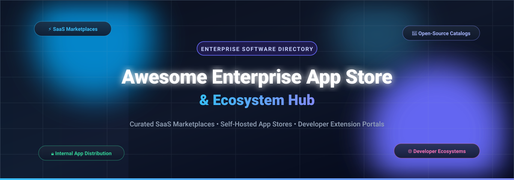

# 🛒 Awesome Enterprise App Store & Ecosystem 🌐

**A Curated Directory of SaaS Marketplaces, Developer Portals, and Open-Source App Store Platforms**  
*Comprehensive benchmarks, pricing breakdowns, developer revenue shares, self-hosted solutions, and internal catalog engines.*

---

## 📌 Table of Contents

- [🔍 Sector Overview & Market Dynamics](#-sector-overview--market-dynamics)
- [☁️ Enterprise SaaS Marketplaces & Ecosystems](#️-enterprise-saas-marketplaces--ecosystems)
- [💻 Open-Source Platforms & App Distribution Engines](#-open-source-platforms--app-distribution-engines)
- [🛠️ Architectural Selection Guide](#️-architectural-selection-guide)
- [🤝 How to Contribute](#-how-to-contribute)
- [💖 Support & Sponsorship](#-support--sponsorship)
- [📈 Star History](#-star-history)
- [⚖️ Disclaimer](#️-disclaimer)

---

## 🔍 Sector Overview & Market Dynamics

The enterprise app store and cloud marketplace sector is projected to surge from **$30 billion to over $163 billion by 2030** in annual transactable software throughput, driven by enterprise software procurement consolidating into unified cloud billing against pre-committed hyperscaler balances (with the broader global enterprise software market exceeding **$300 billion+**).

The market exhibits **highly concentrated, winner-take-most** dynamics:
* **Hyperscaler Dominance**: Major cloud providers (**AWS Marketplace**, **Microsoft AppSource**) command substantial transaction volumes as procurement teams draw down multi-billion-dollar enterprise cloud discount commitments (EDP / MACC).
* **High Switching Costs & Moats**: Leading ecosystem anchors (**Salesforce AppExchange**, **ServiceNow Store**, **Shopify App Store**) leverage profound two-sided network effects. App developers gravitate to existing corporate user bases, creating high barriers to entry for standalone third-party stores.
* **Open-Source Emergence**: To circumvent proprietary rev-share fees (15%–30%) and avoid vendor lock-in, open-source alternatives like **CasaOS**, **Backstage**, **Komi Store**, **Spree**, **CapRover**, **Umbrel**, **Mercur**, and **Panora** provide self-hosted foundations for internal developer portals, mobile app distribution, and zero-GMV marketplaces.

---

## ☁️ Enterprise SaaS Marketplaces & Ecosystems

The following table evaluates the leading commercial enterprise app stores and cloud marketplace platforms, ranked in descending order by parent company size (market capitalization / valuation):

| Product | Company Size (Valuation / Market Cap) | Description | Pricing (Starting) | Free Tier / Trial Limits |
|---|---|---|---|---|
| **[Microsoft AppSource](https://appsource.microsoft.com/)** | ~$3.89 Trillion (Market Cap) | Microsoft's enterprise marketplace for business apps, add-ins, and AI agents across Dynamics 365, Power Platform, Microsoft 365, and Azure. | Flat 3% store service fee for transactable SaaS apps; underlying Dynamics 365 apps start from $50/user/month | Free Account includes $200 trial credit (30 days) + 12 months access to 20+ services + 65+ always-free services (e.g., Azure Functions up to 1M req/mo) |
| **[AWS Marketplace](https://aws.amazon.com/marketplace)** | ~$2.88 Trillion (Market Cap) | Digital catalog for enterprise software, SaaS, and infrastructure services with consolidated AWS billing and drawing down on cloud commits. | 3% transaction fee on public SaaS listings (scales down to 1.5% for $10M+ private offers); underlying AWS compute starts from ~$0.0104/hr for t3.micro | 12-Month Free Tier: 750 hours/mo EC2 (t2/t3.micro), 5 GB S3 storage, 750 hours RDS + Always-Free: 1M AWS Lambda requests/mo & 25 GB DynamoDB storage |
| **[Shopify App Store](https://apps.shopify.com/)** | ~$189 Billion (Market Cap) | Dedicated app and extension marketplace powering multi-channel e-commerce storefronts, inventory, payments, and checkout flows. | 0% commission on the first $1M gross lifetime revenue (15% rev share thereafter + 2.9% processing fee); platform plan starts at $39/mo ($29/mo billed annually) | 3-day full free trial (no credit card required) followed by promotional $1/month for the first 3 months |
| **[Salesforce AppExchange](https://appexchange.salesforce.com/)** | ~$179 Billion (Market Cap) | Enterprise cloud app marketplace offering thousands of partner extensions, pre-built integrations, and business apps for Salesforce CRM. | $0 for free apps; paid listings incur ~$999 security review fee per submission + 15% revenue share (ISVforce); underlying Starter Suite starts at $25/user/month | 30-day free trial for Salesforce Starter Suite / core CRM (full feature access for up to 30 days without commitment); free partner developer org (PBO) |
| **[ServiceNow Store](https://store.servicenow.com/)** | ~$106 Billion (Market Cap) | Marketplace for enterprise certified workflow apps, ITSM modules, and integrations built on the Now Platform. | ~$5,000/year Technology Partner Program Build membership + ~20% store rev share; core ITSM licenses start at ~$70 to $100/fulfiller/month | Free Personal Developer Instance (PDI) with full Now Platform capabilities; hibernates on idle, reclaimed after 10 consecutive days of inactivity |
| **[Atlassian Marketplace](https://marketplace.atlassian.com/)** | ~$38.5 Billion (Market Cap) | App and extension marketplace for Jira, Confluence, Bitbucket, and service management tools. | 0% revenue share on the first $1M lifetime Forge revenue (16%–17% thereafter; legacy Connect apps at 20%–25%); core Jira starts at $9.70/user/month | Free forever plan for up to 10 users on Jira & Confluence (2 GB file storage, standard community support); 30-day free trial on marketplace apps |
| **[Zoho Marketplace](https://marketplace.zoho.com/)** | ~$12.5 Billion (Estimated Private Valuation / ~$1.5B ARR) | Ecosystem hub featuring 2,500+ extensions and integrations across Zoho's suite of business software. | $0 upfront listing/submission fees for developers + ~30% revenue share on paid extension sales; underlying Zoho CRM starts at $14/user/month (annual) | Free forever plan for Zoho CRM up to 3 users (5,000 records, 1 GB organization storage); 15-day free trial on paid plans |
| **[Zendesk Marketplace](https://www.zendesk.com/marketplace/)** | ~$10.2 Billion (Acquisition Valuation / ~$2B+ ARR) | Extension directory for customer support, ticketing, live chat, and conversational AI integrations. | 0% direct commission/rev share from Zendesk (developer brings own Stripe account for billing); Zendesk Support Team plan starts at $19/agent/month (annual) | 14-day free trial with full access to ticketing and support features (no credit card required) |

---

## 💻 Open-Source Platforms & App Distribution Engines

Open-source app store engines, self-hosted distribution platforms, internal developer portals, and multi-vendor marketplace frameworks. Sorted in **descending order by GitHub star count**:

| Project | Star Badge | Description |
|---|---|---|
| **[CasaOS](https://github.com/IceWhaleTech/CasaOS)** |  | **Simple, elegant personal cloud OS with built-in Docker App Store.** Features an intuitive web-based app store interface for one-click installation and management of self-hosted enterprise utilities, home server tools, and containerized services. |
| **[Backstage](https://github.com/backstage/backstage)** |  | **CNCF incubating open framework for building Internal Developer Portals (IDPs).** Originally engineered by Spotify, Backstage provides a centralized software catalog, template marketplace, and an extensible plugin ecosystem for enterprise developer operations. |
| **[Komi Store](https://github.com/komi-store/komi-store)** |  | **Free, open-source cross-platform app store for developer releases.** (Formerly GitHub Store). Browse, discover, install, and update binary releases across GitHub, Codeberg, and Forgejo with unified release metadata. |
| **[Spree Commerce](https://github.com/spree/spree)** |  | **Complete open-source commerce & multi-vendor marketplace platform.** Delivers headless REST APIs, Next.js storefronts, seller syncing, automated split orders, merchant payouts, and DAC7-compliant reporting with zero platform GMV commissions. |
| **[CapRover](https://github.com/caprover/caprover)** |  | **Automated PaaS and one-click application deployment platform.** Provides a modular one-click app store repository allowing teams to deploy hundreds of pre-configured applications, databases, and microservices with automated SSL and Nginx routing. |
| **[Umbrel](https://github.com/getumbrel/umbrel)** |  | **Self-hosted OS featuring an official curated App Store.** Offers an enterprise-grade UI to run, discover, and isolate over 300+ containerized applications, local AI models, and communication hubs with native support for community-driven app store manifests. |
| **[Mercur](https://github.com/mercurjs/mercur)** |  | **Complete open-source multi-vendor marketplace platform.** Built on MedusaJS with MIT-licensed core. Includes vendor portal, operator admin console, storefronts, and Stripe Connect payouts without any per-transaction cuts or GMV percentages. |
| **[Panora](https://github.com/panoratech/Panora)** |  | **Leading open-source embedded integration catalog for SaaS products.** Open alternative to Merge.dev. Provides a unified API layer, multi-tenant connectors, self-service user activation, and enterprise access controls. |
| **[Mobazha](https://github.com/mobazha/mobazha)** |  | **Peer-to-peer commerce and multi-storefront protocol.** Go-based decentralized marketplace engine enabling distributed vendor catalogs, cryptocurrency settlements, and censorship-resistant digital product listings. |
| **[Einstore](https://github.com/Einstore/Einstore)** |  | **Self-hosted enterprise app store for internal mobile app distribution.** Apache-2.0 licensed platform for managing, publishing, and distributing internal iOS (IPA) and Android (APK) enterprise packages independently from public app stores. |

---

## 🛠️ Architectural Selection Guide

Depending on your organization's technical and commercial requirements, select the framework tailored to your architectural domain:

* **For Internal Developer Portals & Microservice Catalogs**: Deploy **[Backstage](https://github.com/backstage/backstage)** to consolidate API docs, plugins, software catalogs, and organizational CI/CD pipelines.
* **For Self-Hosted Containerized App Stores**: Choose **[CasaOS](https://github.com/IceWhaleTech/CasaOS)**, **[CapRover](https://github.com/caprover/caprover)**, or **[Umbrel](https://github.com/getumbrel/umbrel)** for pre-packaged, container-driven app repositories.
* **For Zero-GMV Multi-Vendor Marketplaces**: Build on **[Mercur](https://github.com/mercurjs/mercur)** or **[Spree Commerce](https://github.com/spree/spree)** to eliminate 15%–30% platform cuts and own your vendor databases.
* **For Embedded SaaS Integration Catalogs**: Embed **[Panora](https://github.com/panoratech/Panora)** to offer your end customers a native marketplace of third-party connectors with unified auth.
* **For Internal Mobile Enterprise Distribution**: Use **[Einstore](https://github.com/Einstore/Einstore)** to host and sign internal APK/IPA builds without public App Store approvals.

---

## 🤝 How to Contribute

Contributions are welcome from platform engineers, SaaS architects, and open-source maintainers:

1. 🍴 **Fork** this repository.
2. 🌿 Create a descriptive branch (`git checkout -b feature/add-new-marketplace`).
3. 📝 Add or update entries in [README.md](file:///C:/Users/ishan/Documents/Projects/Awesome-Enterprise-App-Store-Ecosystem/README.md) following the existing Markdown schema and citation guidelines.
4. 🚀 Submit a Pull Request detailing the product's focus, licensing, star badge, and starting price tier.

---

## 💖 Support & Sponsorship

Thank you for exploring and bookmarking **Awesome Enterprise App Store & Ecosystem**! ⭐  
If you find this directory valuable for your engineering team, architecture design, or research:

- ⭐ **Star this repository** to support discoverability.
- 🍴 **Fork it** to maintain internal enterprise references.
- 📢 **Share it** with your network, platform engineers, and DevOps communities.
- ☕ **Buy a coffee or sponsor ongoing maintenance**: Support via the [GitHub Sponsor Dashboard](https://github.com/sponsors/ishandutta2007).

---

## 📈 Star History

---

## ⚖️ Disclaimer

- This is an independent, **community-curated** reference list — not an official endorsement.
- All trademarks, logos, and brand names are property of their respective owners.
- Third-party app marketplaces and integration catalogs process sensitive API tokens, OAuth credentials, and data pipelines; always enforce least-privilege access controls, credential rotation, and audit logging.
